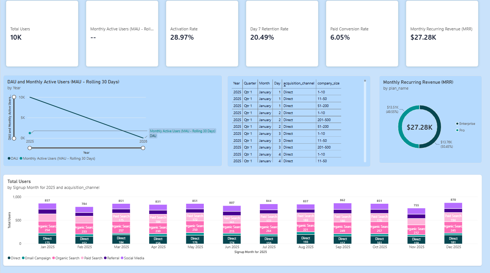
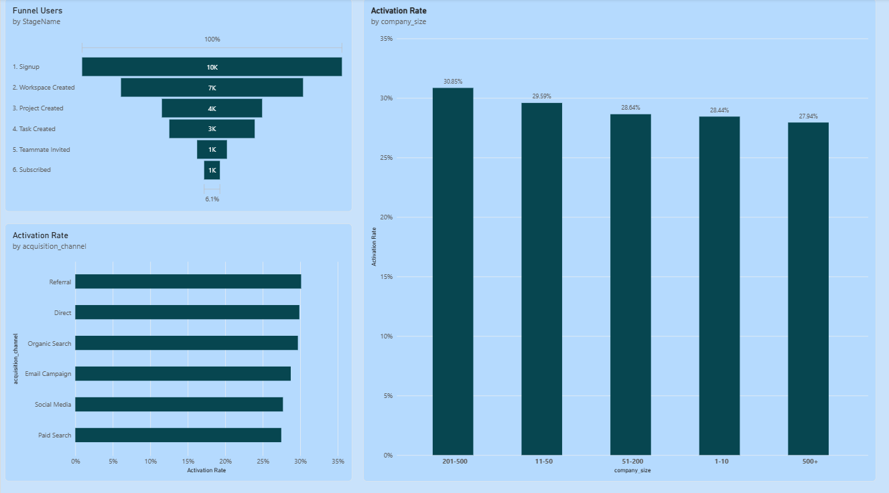
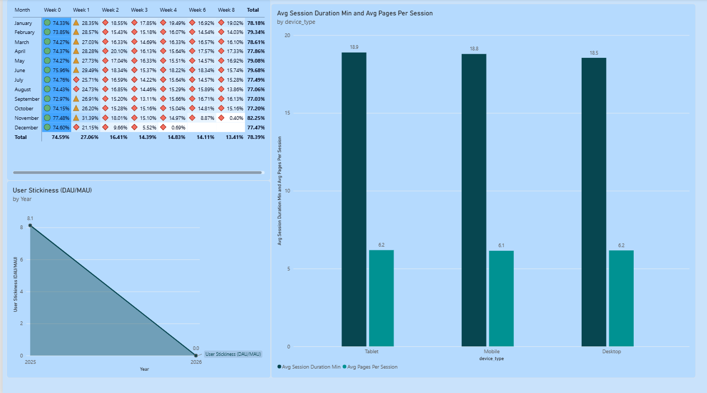
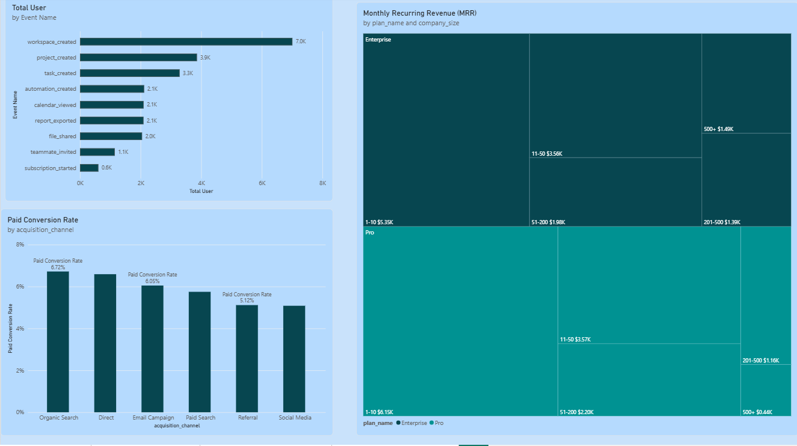

# FlowMetrics: SaaS product analytics

FlowMetrics is a demonstration project for analyzing synthetic product-usage data from a project-management SaaS product. It includes a Python data generator and validator, a CSV-backed Streamlit dashboard, SQL Server schema and analysis scripts, and a Power BI report. The generated data is synthetic and should not be interpreted as real customer or production results.

## Project features

- Generate users, sessions, events, subscriptions, and a feature catalog as CSV files.
- Validate identifiers, relationships, and temporal consistency across generated data.
- Explore acquisition, onboarding, retention, feature adoption, and user segments in Streamlit.
- Optionally load the CSVs into SQL Server and run the T-SQL analysis scripts.
- Review the Power BI report screenshots below or open the `.pbix` file in Power BI Desktop.

## Data workflow

Run commands from the project root:

```text
python/generate_data.py
        |
        v
    data/raw/*.csv
        |
        v
python/data_validation.py
        |
        +---------------------> Streamlit reads data/raw/*.csv
        |
        +---------------------> Optional SQL Server load and analysis
```

The generator replaces the raw CSV files. The Streamlit app reads those raw files directly; there is no separate processed-data generation script in the current project.

## Power BI report

The dashboard covers executive metrics, funnel and activation, retention and engagement, and feature adoption and monetization. Screenshots are included for reference; open [`powerbi/flowmetrics_dashboard.pbix`](powerbi/flowmetrics_dashboard.pbix) in Power BI Desktop to explore the report.

### Executive overview



Acquisition trends, activation and paid conversion, and subscription revenue by plan.

### Funnel and activation



Onboarding and conversion stages, with activation comparisons across user segments. The Streamlit funnel view includes teammate invitation and paid subscription as separate outcomes after task creation; neither is a prerequisite for the other.

### Retention and engagement



Weekly signup cohorts, session behavior by device, and engagement trends.

### Feature adoption and monetization



Product-event adoption, subscription revenue, and conversion by acquisition channel.

## Interactive Streamlit application

The multi-page diagnostic application provides interactive views of acquisition, funnel milestones, cohort retention, feature adoption, user behavior, and product insights.

> **Screenshot placeholders:** Add the corresponding application screenshots to `docs/web_images/` using the filenames below to display them in this section.

<details>
<summary><strong>Click to preview Streamlit application screens</strong></summary>
<br>

### Executive platform overview


### Onboarding funnel explorer


### Weekly cohort retention matrix


### Feature adoption and penetration


### Behavioral user segmentation


### Product insights and experimentation


</details>

## Requirements

- Python 3.11 or compatible
- The packages listed in [`requirements.txt`](requirements.txt)
- Optional: Microsoft SQL Server and the Microsoft ODBC Driver 17 for SQL Server
- Optional: Power BI Desktop to open the `.pbix` report

## Setup and run

Open PowerShell in the project root:

```powershell
python -m venv .venv
.\.venv\Scripts\Activate.ps1
python -m pip install -r requirements.txt
```

Generate and validate the raw CSVs:

```powershell
python python\generate_data.py
python python\data_validation.py
```

Run the Streamlit application from the project root:

```powershell
python -m streamlit run streamlit_app\app.py
```

The dashboard expects the CSV files under `data/raw/`. Run the generator first if those files are absent or you want a fresh synthetic dataset.

To switch appearance, open the app's top-right **Main menu** and choose **Dark**, **Light**, or **System** under **Theme**.

## Optional SQL Server workflow

1. Make sure SQL Server is running and create the `FlowMetrics` database. You can create it in SSMS, or run `CREATE DATABASE FlowMetrics;` in a query window connected to the server.
2. From the project root, run the schema script with `sqlcmd`:

   ```powershell
   sqlcmd -S localhost -d FlowMetrics -E -i "sql\schema.sql"
   ```

   Here, `-S` selects the SQL Server instance, `-d` selects the database, `-E` uses your Windows login, and `-i` supplies the SQL file. Run this command in the project folder so the relative path `sql\schema.sql` resolves. If `sqlcmd` is not recognized, install the Microsoft SQL Server command-line utilities or run the script in SSMS instead. For a named instance, replace `localhost` with its instance name, for example `localhost\SQLEXPRESS`.

   **The schema script drops and recreates the listed `dbo` tables. Back up any data you need before running it.**
3. If needed, update `SERVER` and `DATABASE` in [`python/load_mssql.py`](python/load_mssql.py). The loader uses Windows trusted authentication and the Microsoft ODBC Driver 17.
4. Run the loader from the project root:

   ```powershell
   python python\load_mssql.py
   ```

   The loader deletes and reloads the contents of `dbo.users`, `dbo.sessions`, `dbo.events`, `dbo.features`, and `dbo.subscriptions` in a single transaction. Existing rows in those tables will be replaced.

5. After loading, execute the desired SQL analysis scripts in SSMS or with `sqlcmd`, for example:

   ```powershell
   sqlcmd -S localhost -d FlowMetrics -E -i "sql\03_funnel_analysis.sql"
   ```

## Repository structure

```text
data/
  raw/                         Generated CSV files
docs/
  images/                      Power BI report screenshots
  web_images/                  Streamlit application screenshot placeholders
powerbi/
  flowmetrics_dashboard.pbix   Power BI report
python/
  generate_data.py             Synthetic data generator
  data_validation.py           Raw data validation
  load_mssql.py                SQL Server CSV loader
reports/
  data_dictionary.md            Dataset and SQL schema reference
  product_insights.md           Synthetic-data interpretation and experiment ideas
sql/
  schema.sql                    SQL Server tables and indexes
  01_acquisition.sql            Acquisition analysis
  02_activation.sql             Activation analysis
  03_funnel_analysis.sql        Funnel analysis
  04_engagement.sql             Engagement analysis
  05_retention.sql              Retention analysis
  06_feature_adoption.sql       Feature adoption analysis
  07_conversion.sql              Conversion analysis
  08_user_segmentation.sql      User segmentation
streamlit_app/
  app.py                        Main dashboard
  style.py                      Shared visual helpers
  pages/                        Additional analytics pages
requirements.txt                Python dependencies
```

For table and field definitions, see [`reports/data_dictionary.md`](reports/data_dictionary.md). For interpretation and experiment hypotheses, see [`reports/product_insights.md`](reports/product_insights.md).
